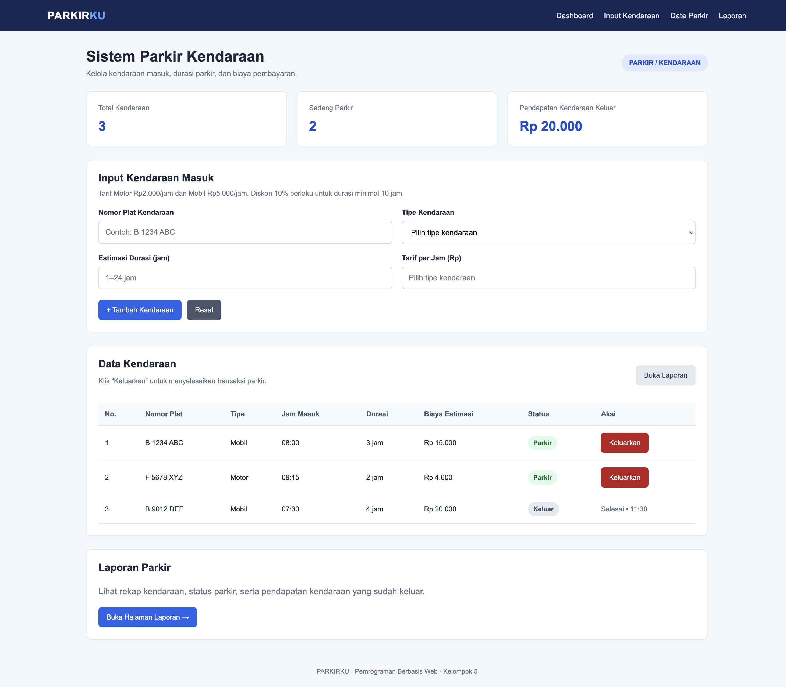
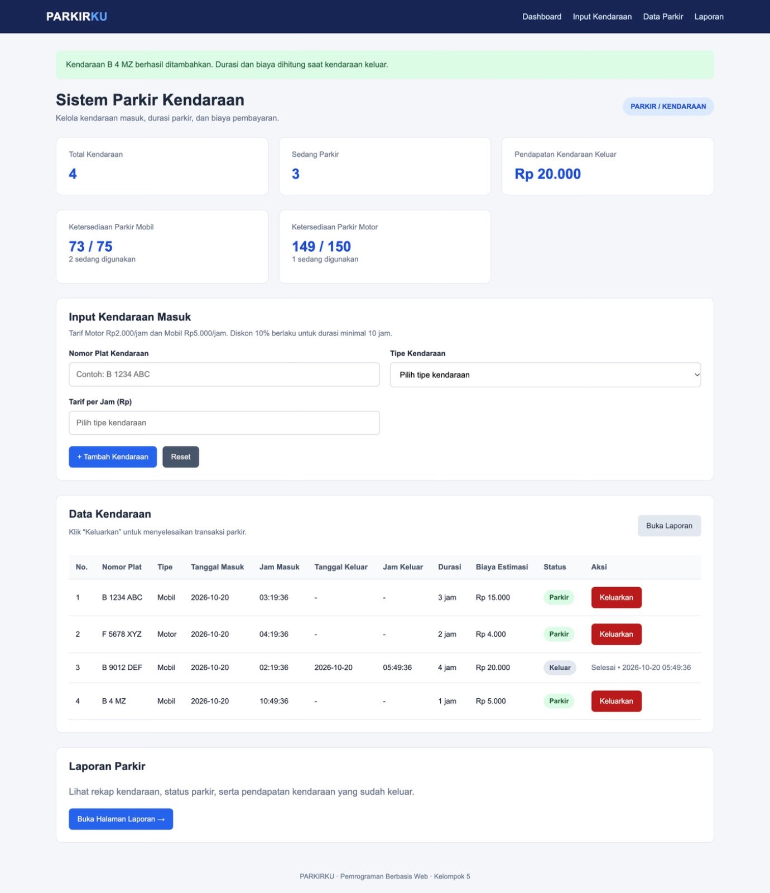
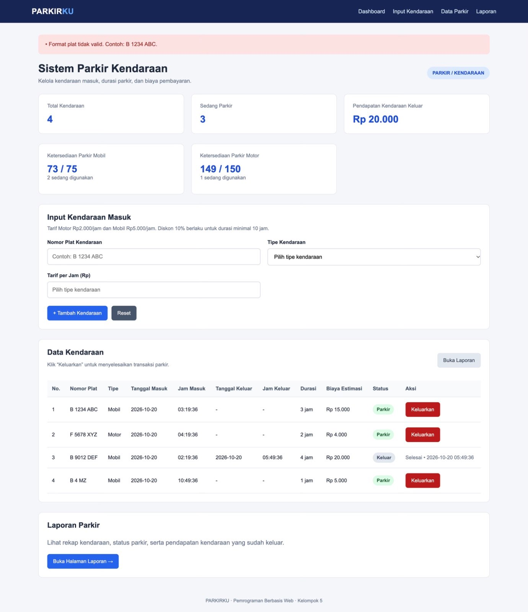
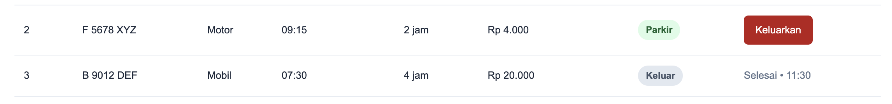
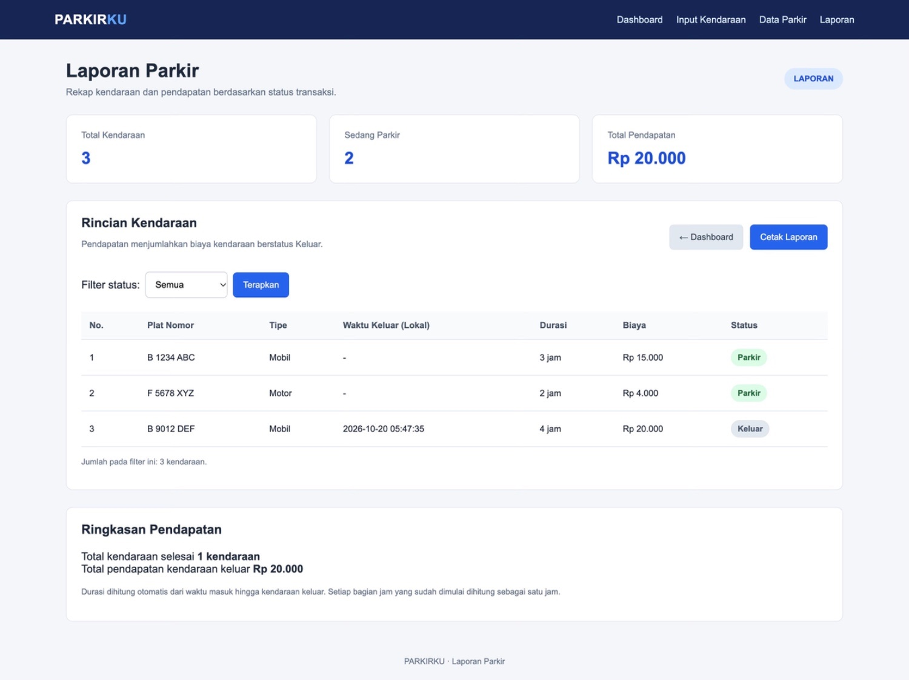
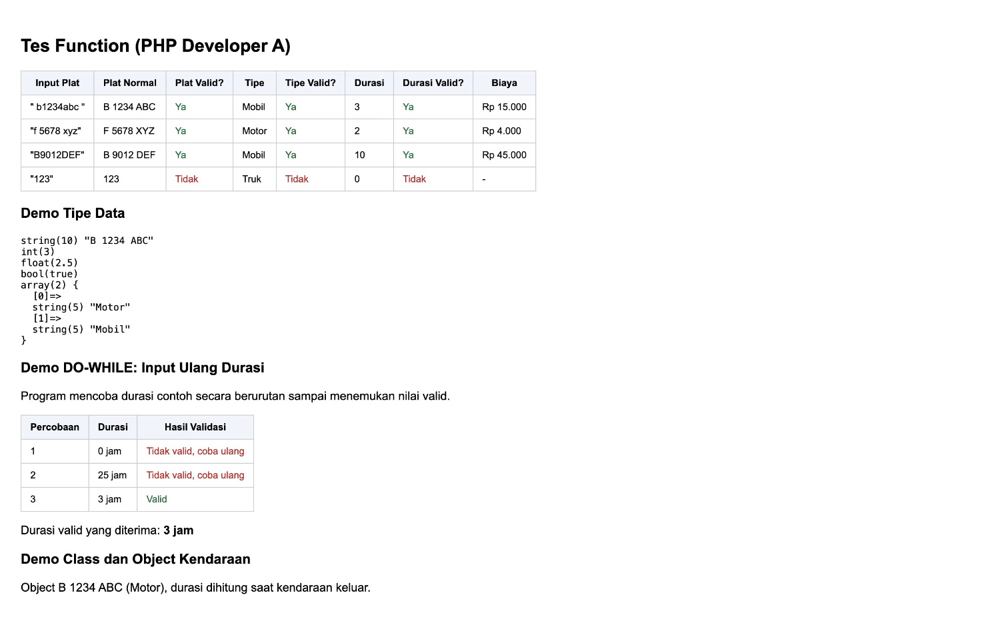

# Sistem Parkir Kendaraan (PARKIRKU)

> Tugas Mata Kuliah Pemrograman Berbasis Web (PBW) — Kelompok 5

PARKIRKU adalah aplikasi web sederhana berbasis PHP Native untuk simulasi pengelolaan kendaraan masuk dan keluar, validasi nomor polisi, perhitungan biaya parkir, serta pencatatan laporan kendaraan.

Aplikasi ini dibuat sebagai penerapan materi Pemrograman Berbasis Web, meliputi variabel, operator, fungsi, percabangan, perulangan, array, pengolahan string, session, dan Object-Oriented Programming (OOP).

---

## 👥 Anggota Kelompok

1. **Bryan Ananda Saputra Hulu** (4524210020)
2. **Dheka Airlangga** (4524210027)
3. **Farhan Ridwan Badhawi** (4524210037)
4. **Muhamad Bachtiar** (4524210141)

---

## 🚀 Panduan Menjalankan Proyek

### 1. Prasyarat

- PHP versi 7.4 atau lebih baru.
- Web browser, seperti Google Chrome, Microsoft Edge, atau Mozilla Firefox.
- XAMPP jika ingin menjalankan aplikasi melalui Apache.

### 2. Menjalankan melalui Terminal

1. Buka Terminal atau PowerShell pada folder proyek yang berisi `index.php`.
2. Jalankan perintah berikut:

   ```bash
   php -S localhost:8000
   ```

3. Buka browser dan akses:

   ```text
   http://localhost:8000
   ```

### 3. Menjalankan melalui XAMPP

1. Salin folder proyek ke direktori `htdocs` XAMPP.
2. Jalankan Apache melalui XAMPP Control Panel.
3. Buka browser dan akses alamat sesuai nama folder proyek, misalnya:

   ```text
   http://localhost/Project_Pbw_Kel5/index.php
   ```

**Catatan:** Data kendaraan disimpan menggunakan PHP Session, bukan database. Data contoh disediakan melalui fungsi `dataContoh()` agar halaman dapat menampilkan data awal ketika session kendaraan belum tersedia.

---

## 📋 Fitur Aplikasi

### 1. Dashboard dan Input Kendaraan

Halaman utama menampilkan statistik kendaraan, informasi tarif, formulir input, dan tabel data parkir.

Pengguna dapat memasukkan nomor polisi dan memilih jenis kendaraan. Waktu parkir dicatat otomatis berdasarkan jam lokal perangkat; durasi dan biaya dihitung ketika kendaraan keluar.

### 2. Normalisasi dan Validasi Nomor Polisi

Sistem merapikan nomor polisi dengan mengubah huruf menjadi kapital, menghapus spasi atau tanda baca yang tidak diperlukan, serta membentuk format nomor polisi yang konsisten.

Contoh:

```text
Input  : b1234abc
Output : B 1234 ABC
```

Sistem juga memvalidasi format nomor polisi dan jenis kendaraan sebelum data diterima.

### 3. Perhitungan Biaya Parkir

Tarif parkir ditentukan berdasarkan jenis kendaraan dan durasi aktual.

| Jenis Kendaraan | Tarif per Jam |
|---|---:|
| Motor | Rp2.000 |
| Mobil | Rp5.000 |

Durasi dibulatkan ke atas per jam yang mulai digunakan, dengan minimal 1 jam. Diskon sebesar 10% diberikan untuk durasi minimal 10 jam; durasi tidak dibatasi 24 jam.

Contoh perhitungan:

- Motor selama 2 jam: Rp4.000.
- Mobil selama 2 jam: Rp10.000.
- Motor selama 10 jam: Rp18.000 setelah diskon 10%.

Perhitungan tersebut menggunakan durasi aktual sejak kendaraan masuk hingga keluar.

### 4. Data Kendaraan dan Proses Keluar

Form tidak meminta estimasi durasi maupun menampilkan jam masuk. Waktu masuk dan keluar dicatat otomatis dari jam lokal perangkat yang mengirimkan transaksi. Durasi dihitung dari selisih waktu masuk dan keluar; setiap bagian jam yang sudah dimulai dihitung sebagai satu jam. Tabel kendaraan menampilkan nomor polisi, jenis kendaraan, jam masuk, jam keluar (setelah admin mencatat kendaraan keluar), durasi berjalan/aktual, biaya, dan status parkir.

Tombol **Keluar** memproses kendaraan melalui `keluar.php`. Sistem mengubah status kendaraan menjadi `Keluar`, mencatat waktu lokal perangkat saat keluar, menghitung durasi aktual, dan menghitung biaya akhir.

Sistem juga mencegah kendaraan dengan nomor polisi yang sama ditambahkan kembali ketika kendaraan tersebut masih berstatus `Parkir`.

### 5. Laporan Parkir

Halaman `laporan.php` menampilkan data kendaraan beserta ringkasan statistik dan pendapatan dari kendaraan yang sudah berstatus `Keluar`.

Fitur laporan meliputi:

- Filter data berdasarkan status `Semua`, `Parkir`, atau `Keluar`.
- Informasi jumlah kendaraan.
- Ringkasan pendapatan.
- Tombol untuk mencetak laporan melalui browser.

---

## 🧩 Struktur File dan Logika PHP

| File | Fungsi |
|---|---|
| `index.php` | Menampilkan dashboard, formulir input, statistik, dan tabel kendaraan. |
| `functions.php` | Menyediakan fungsi normalisasi, validasi, perhitungan biaya, format rupiah, dan statistik. |
| `proses.php` | Memproses input kendaraan, melakukan validasi, memeriksa nomor polisi ganda, dan menyimpan data ke session. |
| `keluar.php` | Memproses kendaraan keluar dan memperbarui status kendaraan. |
| `laporan.php` | Menampilkan laporan kendaraan, filter status, dan ringkasan pendapatan. |
| `classes/Kendaraan.php` | Mendefinisikan class `Kendaraan` untuk merepresentasikan data kendaraan menggunakan OOP. |
| `tes_functions.php` | Menampilkan pengujian fungsi, simulasi perulangan, dan demonstrasi object `Kendaraan`. |
| `assets/css/style.css` | Mengatur tampilan dan desain halaman aplikasi. |

### Fungsi Utama

| Fungsi | Penjelasan |
|---|---|
| `ambilTarif($tipe)` | Mengambil tarif sesuai jenis kendaraan. |
| `hitungBiayaParkir($tipe, $durasi)` | Menghitung biaya parkir dan diskon jika memenuhi ketentuan. |
| `normalisasiPlat($plat)` | Membersihkan dan menyeragamkan format nomor polisi. |
| `validasiPlat($plat)` | Memeriksa format nomor polisi menggunakan regular expression. |
| `validasiDurasi($durasi)` | Memeriksa durasi berupa bilangan bulat antara 1 dan 24 jam. |
| `validasiTipe($tipe)` | Memeriksa apakah jenis kendaraan adalah Motor atau Mobil. |
| `formatRupiah($angka)` | Mengubah angka menjadi format mata uang rupiah. |
| `formatDurasi($jam)` | Menampilkan durasi dalam format jam. |
| `hitungStatistik($data)` | Menghitung total kendaraan, kendaraan yang sedang parkir, kendaraan keluar, dan pendapatan. |
| `dataContoh()` | Menyediakan data contoh untuk tampilan awal aplikasi. |

### Penerapan Materi PBW

- **Variabel dan operator:** digunakan untuk mengolah data kendaraan dan menghitung biaya.
- **Fungsi:** digunakan untuk memisahkan proses validasi, perhitungan, dan pengolahan data.
- **String:** digunakan untuk membersihkan dan memformat nomor polisi.
- **Array:** digunakan untuk menyimpan serta mengolah daftar kendaraan.
- **Percabangan:** digunakan untuk validasi dan menentukan hasil proses.
- **Perulangan `while`:** digunakan untuk memeriksa nomor polisi yang masih berstatus parkir di `proses.php`.
- **Perulangan `for`:** digunakan untuk menampilkan atau menelusuri data kendaraan.
- **Perulangan `do-while`:** digunakan untuk menampilkan data pada tabel laporan.
- **OOP:** class `Kendaraan` digunakan untuk memvalidasi data dan membentuk object kendaraan.
- **Session:** digunakan untuk mempertahankan data kendaraan selama session berlangsung.

---

## 🧪 Skenario Pengujian

Pengujian berikut dapat dilakukan melalui browser setelah aplikasi dijalankan.

| No. | Fitur | Skenario Pengujian | Hasil yang Diharapkan |
|---:|---|---|---|
| 1 | Input kendaraan | Memasukkan nomor polisi yang valid, memilih tipe kendaraan, dan mengisi durasi. | Kendaraan berhasil ditambahkan dan muncul pada tabel. |
| 2 | Validasi form | Mengosongkan nomor polisi lalu mengirim formulir. | Formulir menolak input kosong. |
| 3 | Validasi nomor polisi | Memasukkan nomor polisi dengan format yang tidak sesuai. | Sistem menampilkan pesan kesalahan validasi. |
| 4 | Perhitungan biaya | Memasukkan jenis kendaraan dan durasi tertentu. | Biaya sesuai tarif dan ketentuan diskon. |
| 5 | Nomor polisi ganda | Menambahkan nomor polisi yang masih berstatus `Parkir`. | Sistem menolak penambahan kendaraan yang sama. |
| 6 | Proses keluar | Menekan tombol `Keluar` pada kendaraan yang masih parkir. | Status berubah menjadi `Keluar` dan kendaraan masuk dalam laporan. |
| 7 | Laporan | Membuka halaman laporan dan mencoba filter status. | Data ditampilkan sesuai filter yang dipilih. |
| 8 | Pengujian fungsi | Membuka `tes_functions.php`. | Hasil pengujian validasi, perhitungan, perulangan, dan class dapat diamati. |

**Status pengujian:** Isi hasil pengujian berdasarkan percobaan langsung pada aplikasi. Tandai setiap skenario lulus atau gagal sesuai hasil yang benar-benar diperoleh.

---

## ⚠️ Catatan dan Batasan Aplikasi

1. Aplikasi menggunakan PHP Session untuk menyimpan data, sehingga belum menggunakan database permanen.
2. Durasi parkir dihitung otomatis dari waktu masuk hingga waktu keluar, dengan pembulatan ke atas untuk setiap jam yang mulai digunakan.
3. Waktu masuk dan keluar dicatat otomatis berdasarkan jam lokal perangkat pengguna.
4. Biaya akhir dihitung menggunakan durasi aktual berdasarkan selisih waktu masuk dan keluar.
5. Kapasitas slot parkir dan pembaruan durasi secara real-time belum dicantumkan sebagai fitur karena belum terkonfirmasi pada source code yang diperiksa.

---

## 📸 Dokumentasi dan Bukti Hasil

Tambahkan screenshot asli dari aplikasi ke folder `screenshots/`, lalu gunakan nama file berikut agar dokumentasi mudah diatur.

1. `dashboard.png` — tampilan dashboard dan formulir input.

2. `input-berhasil.png` — hasil penambahan kendaraan.

3. `validasi-error.png` — pesan kesalahan input.

4. `kendaraan-keluar.png` — hasil proses kendaraan keluar.

5. `laporan.png` — tampilan laporan parkir.

6. `testing-fungsi.png` — hasil pengujian fungsi pada `tes_functions.php`.


---

## 🔗 Repository

Source code proyek tersedia di GitHub:

https://github.com/DhekaAirlangga/Project_Pbw_Kel5.git

---

## 📌 Kesimpulan

PARKIRKU merupakan aplikasi simulasi pengelolaan parkir berbasis PHP Native yang menerapkan konsep dasar Pemrograman Berbasis Web. Aplikasi menyediakan fitur input kendaraan, validasi nomor polisi, perhitungan biaya parkir, pencatatan kendaraan keluar, dan laporan.

Melalui proyek ini, kelompok kami dapat mempraktikkan penggunaan fungsi, array, string, perulangan, session, dan OOP dalam sebuah aplikasi web sederhana.